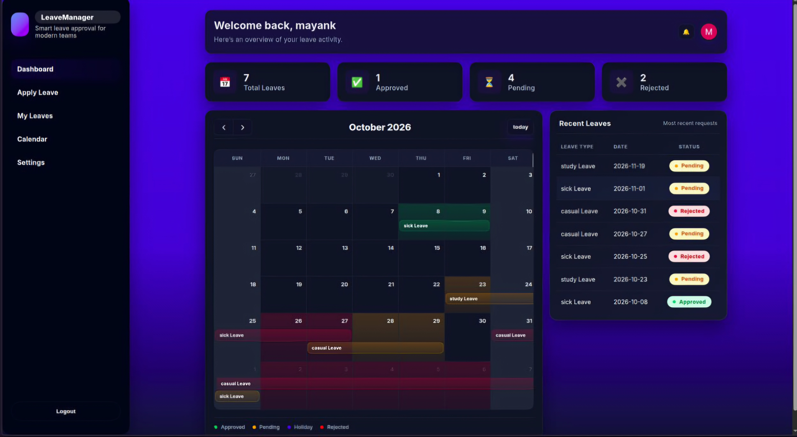
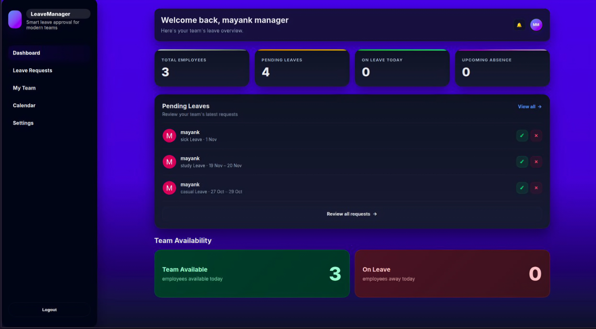
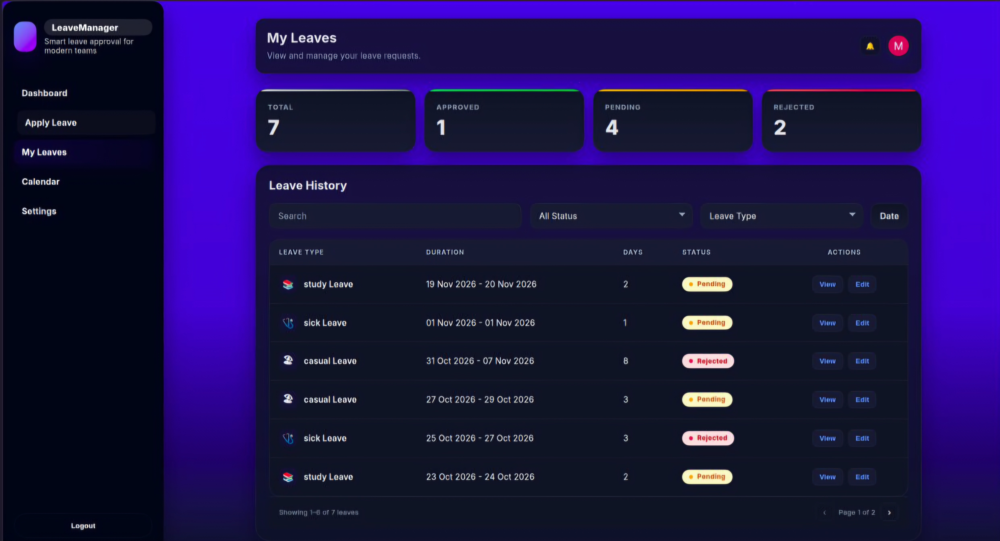

# Leave Management System

A full-stack web application designed to simplify employee leave management, streamline leave approval workflows, and help managers manage employee leave requests efficiently.

**Live Demo:** [Leave Management System](https://leave-management-system-sigma-five.vercel.app/)

**GitHub Repository:** [Mayanksharma3012/Leave-Management-System](https://github.com/Mayanksharma3012/Leave-Management-System)

---

## Project Overview

The Leave Management System is a MERN-based web application that provides a centralized platform for managing employee leave requests.

Employees can apply for leave, track their leave balances, view application history, and upload supporting documents. Managers can review employee leave requests, approve or reject applications, and access uploaded documents.

The application implements role-based access control to provide separate functionalities for employees and managers.


## Screenshots

### Employee Dashboard



### Manager Dashboard



### Employee Leaves



### Manager Leave Requests


---

## Features

### Employee Features

- **Employee Authentication:** Secure login and registration.
- **Leave Application:** Submit leave requests with relevant details.
- **Leave Balance:** View available leave balances.
- **Leave History:** Track previous and current leave applications.
- **Document Upload:** Upload supporting documents with leave applications.
- **Application Status:** Track pending, approved, and rejected requests.
- **Protected Routes:** Access employee-specific pages through role-based authorization.

### Manager Features

- **Manager Authentication:** Dedicated manager access.
- **Leave Management:** View employee leave applications.
- **Approve or Reject Requests:** Manage employee leave applications.
- **Document Access:** View supporting documents uploaded by employees.
- **Protected Manager Routes:** Restrict manager functionality to authorized users.

### Security & Authentication

- Role-based access control for employees and managers.
- Protected backend routes using authentication middleware.
- Firebase Admin integration.
- Google and GitHub OAuth integration.
- Secure handling of environment variables.

### File Management

- Cloudinary integration for document storage.
- Document uploads associated with leave applications.
- Managers can access uploaded supporting documents.

---

## Technology Stack

### Frontend

- React.js
- JavaScript
- CSS
- Axios
- React Router
- Firebase Authentication

### Backend

- Node.js
- Express.js
- MongoDB
- Mongoose
- JWT Authentication
- Firebase Admin SDK
- Cloudinary

### Deployment & Tools

- Vercel – Frontend hosting
- Render – Backend hosting
- MongoDB Atlas – Database hosting
- Cloudinary – File storage
- Git & GitHub – Version control

---

## Project Structure

```text
Leave-Management-System/
│
├── Backend/
│   ├── DB/
│   ├── controller/
│   ├── middlewares/
│   ├── models/
│   ├── routes/
│   ├── uploads/
│   ├── app.js
│   ├── firebase-admin.js
│   └── package.json
│
├── Frontend/
│   ├── src/
│   │   ├── assets/
│   │   ├── components/
│   │   ├── context/
│   │   ├── pages/
│   │   ├── App.jsx
│   │   └── main.jsx
│   └── package.json
│
├── screenshots/
│
├── README.md
└── .gitignore
```

---

## Getting Started

Follow these instructions to run the project locally.

### 1. Clone the Repository

```bash
git clone https://github.com/Mayanksharma3012/Leave-Management-System.git
```

Navigate into the project:

```bash
cd Leave-Management-System
```

### 2. Setup the Backend

```bash
cd Backend
npm install
```

Create a `.env` file inside the Backend directory and configure your environment variables.

```env
PORT=5000
MONGO_URI=your_mongodb_connection_string
JWT_SECRET=your_jwt_secret

CLOUDINARY_NAME=your_cloudinary_name
CLOUDINARY_API_KEY=your_cloudinary_api_key
CLOUDINARY_API_SECRET=your_cloudinary_api_secret

FIREBASE_SERVICE_ACCOUNT_BASE64=your_firebase_service_account_base64
```

Make sure the environment variable names match those used in your backend source code.

Start the backend:

```bash
npm run dev
```

If your package scripts use a different command, use the corresponding command from `Backend/package.json`.

### 3. Setup the Frontend

Open another terminal:

```bash
cd Frontend
npm install
```

Configure the frontend environment variables required by your Firebase and backend API configuration.

For example:

```env
VITE_API_URL=http://localhost:5173
```

Use the variable name expected by your frontend source code.

Start the frontend:

```bash
npm run dev
```

### 4. Open the Application

Visit the local development URL provided by Vite, usually:

```text
http://localhost:5173
```

---

## Environment Variables

The application requires the following services to be configured:

| Variable / Configuration | Purpose |
|---|---|
| MongoDB URI | Database connection |
| JWT Secret | Token authentication |
| Cloudinary Name | Cloudinary account |
| Cloudinary API Key | Cloudinary authentication |
| Cloudinary API Secret | Secure file operations |
| Firebase Service Account | Firebase Admin authentication |
| Firebase Client Configuration | Frontend authentication |
| Backend API URL | Frontend-backend communication |

**Important:** Never commit `.env` files, Firebase service account credentials, API secrets, or other sensitive configuration files to GitHub.

---

## Application Workflow

1. An employee registers or logs into the application.
2. The employee accesses their dashboard.
3. The employee submits a leave application with the required information.
4. Supporting documents can be uploaded when needed.
5. The manager accesses the manager dashboard.
6. The manager reviews the leave request and supporting documents.
7. The manager approves or rejects the application.
8. The employee can track the updated application status.

---

## Deployment

The application is deployed using:

- **Frontend:** Vercel
- **Backend:** Render
- **Database:** MongoDB Atlas
- **File Storage:** Cloudinary

The frontend communicates with the deployed Express backend through API requests.

---

## Future Improvements

The following features can be considered for future development:

- HR/Admin dashboard.
- Configurable company leave policies.
- Automatic monthly and quarterly leave accrual.
- Year-end leave balance processing.
- Leave carry-forward and encashment.
- Company holiday management.
- Team availability calendar.
- Email and in-app notifications.
- Leave analytics and reports.
- Multi-level leave approval workflows.
- Attendance management.

---

## Learning Outcomes

Building this project provided practical experience with:

- Full-stack application development using the MERN stack.
- REST API development using Express.js.
- MongoDB database design and integration.
- Authentication and role-based authorization.
- Frontend-backend integration.
- File uploads and cloud storage.
- Environment variable management.
- Deploying full-stack applications.
- Debugging real-world deployment and integration issues.

---

## Author

**Mayank Sharma**

B.E. Computer Science Student | Full-Stack Developer

- GitHub: [@Mayanksharma3012](https://github.com/Mayanksharma3012)
- Project: [Leave Management System](https://github.com/Mayanksharma3012/Leave-Management-System)
- Live Demo: [Try the Application](https://leave-management-system-sigma-five.vercel.app/)

---

If you find this project interesting, consider giving the repository a ⭐ on GitHub!

**Built with passion and a focus on learning full-stack development.**
